# PulseIQ Analytics Warehouse — ER Diagram

## Design notes

- Employee facts use `employee_key` where available to preserve employee history.
- Date-based facts connect to `dim_date` using the applicable date keys.
- Company-wide forecasts use `forecast_scope = 'COMPANY'` and a NULL `department_id`.
- The calendar was extended through 2027-03-31 for forecast reporting.
- Monthly budget and KPI tables use their `month` date to map to the calendar.
- Two payroll records have `employee_key = -1`; these are documented unresolved source-data exceptions.

## Relationships

```mermaid
erDiagram
    dim_employee ||--o{ fact_payroll : employee_key
    dim_date ||--o{ fact_payroll : date_key
    dim_department ||--o{ fact_payroll : department_id
    dim_role ||--o{ fact_payroll : role_id

    dim_employee ||--o{ fact_attendance_monthly : employee_key
    dim_date ||--o{ fact_attendance_monthly : date_key
    dim_department ||--o{ fact_attendance_monthly : department_id

    dim_employee ||--o{ fact_leave : employee_key
    dim_leave_type ||--o{ fact_leave : leave_type_code
    dim_date ||--o{ fact_leave : start_date_key
    dim_date ||--o{ fact_leave : end_date_key

    dim_date ||--o{ fact_headcount_monthly : date_key
    dim_department ||--o{ fact_headcount_monthly : department_id

    dim_date ||--o{ fact_ledger : date_key
    dim_account ||--o{ fact_ledger : account_code
    dim_department ||--o{ fact_ledger : cost_center_department_id

    dim_client ||--o{ fact_invoice : client_id
    dim_date ||--o{ fact_invoice : invoice_date_key
    dim_account ||--o{ fact_invoice : service_line_account

    fact_invoice ||--o{ fact_invoice_payment : invoice_id
    dim_date ||--o{ fact_invoice_payment : payment_date_key

    dim_vendor ||--o{ fact_expense : vendor_id
    dim_account ||--o{ fact_expense : category_account
    dim_department ||--o{ fact_expense : department_id
    dim_date ||--o{ fact_expense : expense_date_key

    dim_team ||--o{ fact_task : team_id
    dim_sprint ||--o{ fact_task : sprint_id
    dim_employee ||--o{ fact_task : assignee_employee_id

    dim_employee ||--o{ fact_anomaly : employee_id
    dim_date ||--o{ fact_anomaly : period_key

    dim_employee ||--o{ fact_attrition_risk : employee_key
    dim_department ||--o{ fact_attrition_risk : department_id
    dim_date ||--o{ fact_attrition_risk : as_of_date_key

    dim_department ||--o{ fact_forecast : department_id
    dim_date ||--o{ fact_forecast : forecast_month_key

    dim_department ||--o{ budget_payroll_dept_month : department_id
    dim_date ||--o{ budget_payroll_dept_month : month

    dim_department ||--o{ kpi_targets : department_id
    dim_date ||--o{ kpi_targets : month
```

## Data-quality notes

- Two payroll records (`PI-X0003` and `PI-X0004`) have `employee_key = -1` and no matching employee dimension record. They are retained and documented as unresolved exceptions.
- Company-wide forecast rows use `forecast_scope = 'COMPANY'` with `department_id = NULL`; department-level forecasts use `forecast_scope = 'DEPARTMENT'`.
- Source row counts reconcile to Task 1. The warehouse calendar contains 90 additional rows to support forecast dates through 2027-03-31.
- Employee history must be joined using `employee_key`, not only `employee_id`, so historical costs remain attributed to the correct employee version and department.
- If an employee moves from Sales to Support in July, June pay belongs to Sales because the June fact uses the employee version valid for that period.
