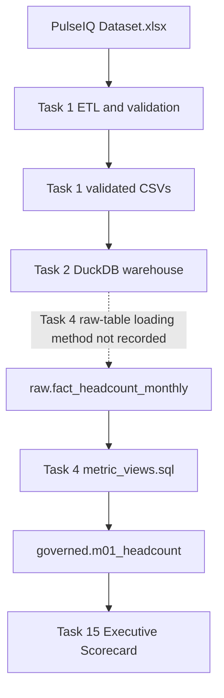
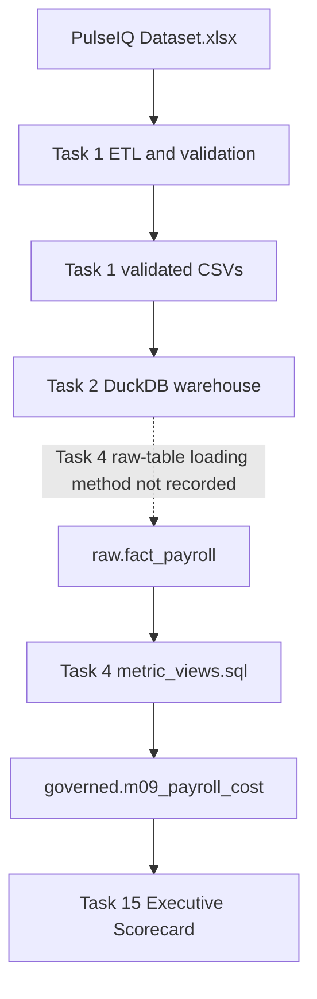
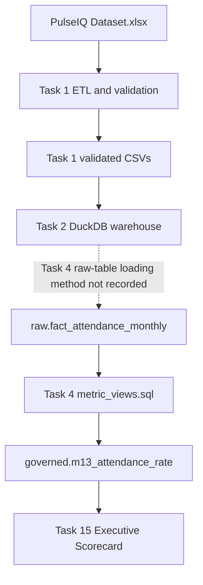
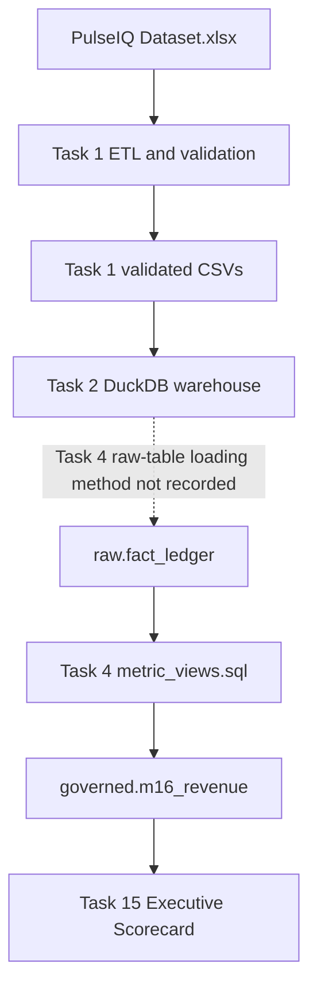
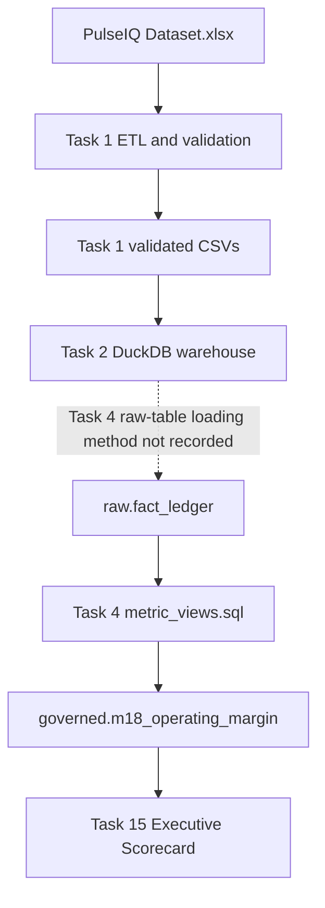

# PulseIQ — Task 19 Metric Lineage

## 1. M01 — Headcount

- Grain: month and department
- Suppression: groups smaller than 5

## 2. M09 — Payroll Cost

- Formula: SUM(employer_cost)
- Grain: month and department
- Suppression: groups smaller than 5
- Unit: INR

## 3. M13 — Attendance Rate

- Formula: (present_days + 0.5 * half_days_unpaid) / scheduled_days
- Grain: month and department
- Suppression: groups smaller than 5
- Unit: ratio; multiply by 100 for percentage display

## 4. M16 — Revenue

- Formula: -SUM(signed_amount_debit_positive)
- Grain: posting month and account code
- Revenue account codes: 4001–4004
- Unit: INR; preserve account-level values

## 5. M18 — Operating Margin

- Formula: 100 * net_profit / revenue, rounded to 2 decimal places
- Grain: company and posting month
- Unit: percent
